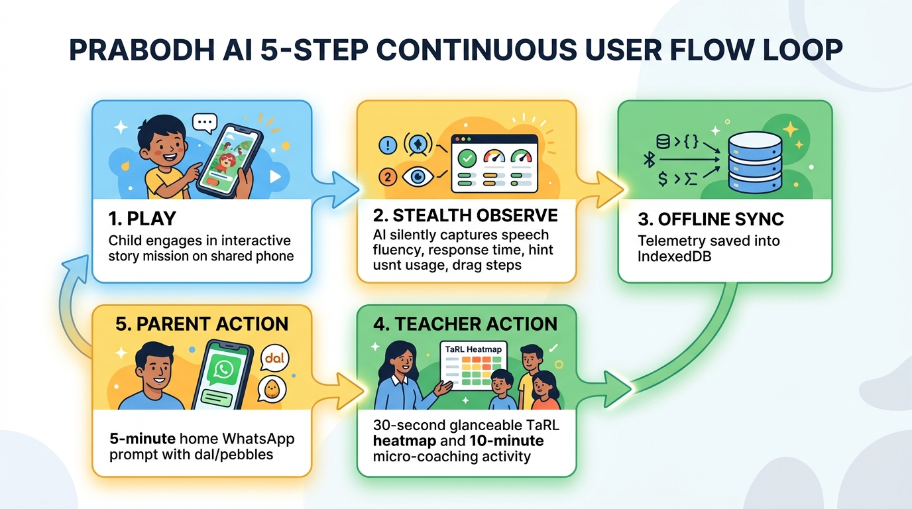
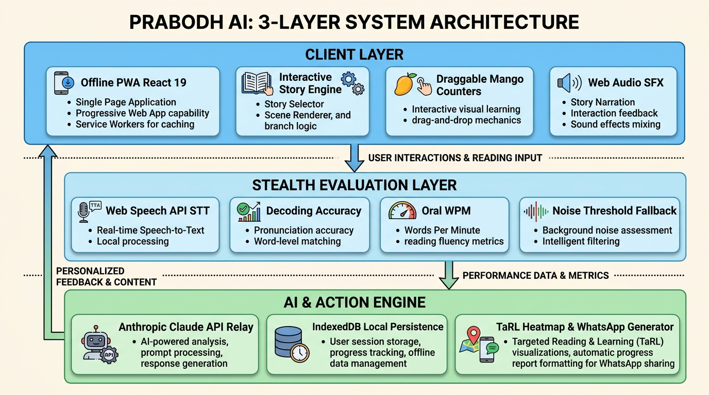

<div align="center">


<br />

# PRABODH · प्रबोध

### Learning that feels like an adventure.

**A story-led, offline-first learning and assessment companion for foundational literacy and numeracy (FLN), designed for Grades 2–3.**

<br />

<a href="https://prabodh-ch4y.onrender.com/"><strong>▶ &nbsp; Explore the live MVP</strong></a>
&nbsp; · &nbsp;
<a href="https://github.com/me13krishna/PRABODH">View the source</a>

<br /><br />


</div>

---

## The idea

Assessment should feel like play—not a test. **PRABODH** turns foundational learning checks into short, interactive story missions that help children practise while giving teachers a clearer picture of what each learner is ready to learn next.

Built for resource-constrained classrooms and low-end devices, the app keeps learning progress on the device and is designed to work without an active internet connection during classroom use.

## A glimpse inside

<div align="center">
  
  <br />
  <em>From a child's story mission to practical classroom insights.</em>
</div>

## What you can do

| For learners | For teachers | For families |
| --- | --- | --- |
| Explore six story missions with interactive activities and playful feedback. | Review a TaRL-aligned mastery heatmap across literacy and numeracy levels. | Share simple five-minute learning activities for home. |
| Practise in English, Hindi, or Marathi, with voice input where supported. | Use learning gaps to guide a suggested 45-minute lesson for the next day. | Export a progress card as an image for WhatsApp. |
| Build literacy and numeracy skills without the pressure of a conventional test. | Keep student progress and assessment records available offline on the device. | Reinforce classroom learning with familiar, everyday objects. |

### Story missions

Meet **Rani at her stall**, help **Birbal with his khichdi**, go on a **jungle safari**, count **Meena's pebbles**, solve **market maths**, and outsmart the **clever rabbit**. Activities touch addition, subtraction, place value, reading comprehension, and pronunciation.

## Designed for the classroom

- **Offline-first progress:** student progress, streaks, and assessment data are stored locally with IndexedDB.
- **Multilingual by design:** switch between English, Hindi, and Marathi.
- **Voice-enabled practice:** uses the browser's Web Speech API for supported languages and devices.
- **Hands-on interactions:** drag-and-drop counters, sound cues, and celebratory animations make practice engaging.
- **Teacher insights:** a TaRL-aligned view and lesson suggestions help turn observations into next steps.

> Voice recognition depends on browser and device support. Some browsers may require an internet connection for speech recognition, even when the rest of the app is available offline.

## How it is put together

<div align="center">
  
</div>

| Layer | Tools and responsibilities |
| --- | --- |
| Experience | React 19, Vite, Tailwind CSS, and Framer Motion |
| Activities | Story missions, drag-and-drop interactions, Web Speech API, and Web Audio |
| Local data | IndexedDB via `idb` for offline-first progress |
| Sharing | `html-to-image` for parent-ready progress cards |
| Hosting | Render static site |

## Run it locally

### Requirements

- Node.js **20.19+** or **22.12+**
- npm

### Setup

```bash
git clone https://github.com/me13krishna/PRABODH.git
cd PRABODH
npm install
npm run dev
```

Open the local URL printed by Vite (usually `http://localhost:5173`).

### Production build

```bash
npm run build
npm run preview
```

## Live MVP

Try PRABODH here: **[prabodh-ch4y.onrender.com](https://prabodh-ch4y.onrender.com/)**

The app is hosted as a Render Static Site. The repository also includes a Render blueprint and a GitHub Actions workflow.

## License

Open-source project for educational empowerment in Indian primary schools. See the repository for license details.

---

<div align="center">
  <sub>Made for curious minds, confident teachers, and joyful learning.</sub>
</div>
